# 💻 Awesome Terminal Operating System & TUI Utilities

  

  
  
  
  
  
  

---

## ⚡ Top Terminal Operating System & TUI Utilities Ecosystem

> 🚀 **A curated directory of next-generation terminal operating systems, modal window managers, GPU-accelerated terminal emulators, multiplexers, and rich TUI frameworks for modern command-line power users and autonomous agent workflows.**

*Last updated: November 2026*

This repository tracks notable **SaaS/commercial platforms** and **open-source GitHub projects** powering the modern **Terminal Operating System & TUI Utilities** revolution. These developer-first tools transform standard terminal consoles into complete, intelligent workspaces via modal tiling, persistent daemon sessions, agent-aware pane orchestration, GPU-accelerated low-latency rendering, and declarative TUI component frameworks.

---

## 📑 Table of Contents

- [📊 Sector Overview & Market Dynamics](#-sector-overview--market-dynamics)
- [☁️ SaaS & Commercial Platforms](#️-saas--commercial-platforms)
- [🌟 Open-Source GitHub Projects](#-open-source-github-projects)
- [🛠️ Key Utilities & Modern CLI Additions](#️-key-utilities--modern-cli-additions)
- [🤝 How to Contribute](#-how-to-contribute)
- [💖 Support](#-support)
- [📈 Star History](#-star-history)
- [📜 Disclaimer](#-disclaimer)

---

## 📊 Sector Overview & Market Dynamics

The developer terminal tooling and terminal emulation market represents a vital, high-growth segment within the broader **$5.5B+ global software development tools and developer productivity ecosystem**. 

This sector is **highly fragmented**, driven by diverse multi-platform environments (macOS Metal, Linux Wayland/X11, and Windows WSL/ConPTY), contrasting keyboard-first user workflows (Vim/modal bindings vs. GUI-centric paradigms), and the relentless rise of modular, unbundled CLI stacks. Rather than coalescing into a single "winner-take-all" monolith, market dynamics favor specialized coexistence: open-source GPU emulators (such as Ghostty, Alacritty, Kitty, and WezTerm) command developer loyalties on performance and minimalism, while VC-backed and cloud-native entrants (such as Warp, Termius, and Amazon Q Developer CLI) monetize collaborative agentic workflows, encrypted multi-device credential sync, and managed cloud infrastructure.

---

## ☁️ SaaS & Commercial Platforms

The following commercial products and managed cloud platforms offer AI-assisted terminal capabilities, multi-device credential synchronization, and hosted terminal sharing infrastructure. Products are sorted descending by company size (valuation / funding / estimated revenue).

| 🏢 Platform | 💰 Pricing (Starting Tier) | 🎁 Free Tier Limits | 🏢 Company Size / Valuation / Revenue | 📝 Description |
| :--- | :--- | :--- | :--- | :--- |
| **[Amazon Q Developer CLI](https://amazon.com)** | **$19 / user / month** (Pro Tier) | **Free forever**: Capped at **50 agentic requests/month**, 1,000 lines of Java code transformation, and 50 security scans/month via AWS Builder ID | **~$2.1T Market Cap** (Amazon / AWS Enterprise Division) | Cloud-connected terminal productivity layer (formerly Fig) integrating IDE autocomplete, inline AI assistance, and shared team CLI workflows. |
| **[Warp](https://warp.dev)** | **$20 / month** ($18/mo billed annually for Build Plan) | **Free forever**: Full access to core modern terminal, command block UI, history search, and Warp Agent CLI; **0 bundled managed AI credits/month** (requires Pay-As-You-Go add-on or Bring-Your-Own-Key [BYOK]) | **$50M Series B** (Total funding ~$73M led by Sequoia Capital, ~$300M+ valuation estimate) | Modern, Rust-based GPU terminal with integrated AI agent workflows, block-based command output, collaborative Warp Drive notebooks, and team workspace sync. |
| **[Charm Cloud](https://charm.sh)** | **$0 Community / BYOK** (Self-hostable open source core; enterprise sponsorships & managed cloud gateways) | **Free forever**: Unlimited local usage & self-hosted instances (`charm serve`), community key-value storage (`Charm KV`), and user filesystem sync (`Charm FS`) | **$10M Total Funding** ($6M round led by Google Gradient Ventures, Series A valuation ~$30M–$50M est.) | Cloud-backed identity, encrypted key-value storage, and filesystem sync infrastructure designed to power Charm CLI and interactive TUI applications. |
| **[Termius](https://termius.com)** | **$10 / month** (Pro Plan billed annually) | **Free forever**: Basic SSH & SFTP client on a **single local device only**; **0 cross-device sync**, 0 cloud backup, and 0 team vaults included | **~$4M ARR** (~$2.7M–$4.25M Seed funding raised; Y Combinator alumnus) | Cross-platform SSH, Mosh, and SFTP client featuring end-to-end encrypted vault sync, snippet sharing, and team session management across desktop and mobile. |
| **[Textualize / Textual Web](https://www.textualize.io/)** | **$0 Free / Open-Source Core** (Commercial entity wound down; standalone open-source service) | **Free forever**: Unrestricted self-hosted terminal-to-web sharing via `textual-web` CLI; unlimited local web rendering sessions | **Seed-funded** (Backed by Costanoa Ventures; commercial operations wound down into independent open-source) | Platform and tooling ecosystem enabling Python Textual TUI applications to be served and shared effortlessly in web browsers alongside local terminals. |
| **[Tabby Sync](https://tabby.sh)** | **$0 Free / Open-Source** (Community-funded via Open Collective & Patreon from ~$5/month) | **Free forever**: Unlimited terminal usage, unlimited self-hosted configuration sync via `tabby-web` Docker container, and free public community sync servers | **Community-Funded Open Source** (~$15K–$25K/yr Open Collective / GitHub Sponsors) | Cloud configuration and profile synchronization services for the Tabby terminal emulator across multiple workstations. |

---

## 🌟 Open-Source GitHub Projects

Curated open-source terminal window managers, terminal emulators, multiplexers, and TUI development frameworks. **Sorted descending by GitHub stargazer count.**

| 📦 Repository & Link | ⭐ GitHub_Stars | 💻 Primary Tech | 📝 Description |
| :--- | :--- | :--- | :--- |
| **[junegunn/fzf](https://github.com/junegunn/fzf)** |  | Go | Blazing-fast, general-purpose command-line fuzzy finder and interactive filter for files, command history, and shell pipelines. |
| **[jesseduffield/lazygit](https://github.com/jesseduffield/lazygit)** |  | Go | Simple, lightning-fast terminal UI for Git commands, staging hunks, interactive rebasing, and branch navigation. |
| **[Eugeny/tabby](https://github.com/Eugeny/tabby)** |  | TypeScript / Electron | Highly configurable, extensible cross-platform terminal emulator, SSH client, and serial console with tabbed panes and theme plugins. |
| **[BurntSushi/ripgrep](https://github.com/BurntSushi/ripgrep)** |  | Rust | Ultra-fast command-line search tool that recursively searches directories for regex patterns while respecting `.gitignore`. |
| **[alacritty/alacritty](https://github.com/alacritty/alacritty)** |  | Rust | Fast, cross-platform, OpenGL-accelerated terminal emulator focused strictly on minimal latency, simplicity, and performance. |
| **[ghostty-org/ghostty](https://github.com/ghostty-org/ghostty)** |  | Zig | Fast, feature-rich, cross-platform terminal emulator that uses platform-native UI toolkits, GPU acceleration, and full Kitty graphics support. |
| **[sharkdp/bat](https://github.com/sharkdp/bat)** |  | Rust | A `cat(1)` clone with syntax highlighting, Git integration, automatic paging, and terminal formatting. |
| **[starship/starship](https://github.com/starship/starship)** |  | Rust | Minimal, blazing-fast, and infinitely customizable cross-shell prompt showing contextual git status, runtime versions, and environments. |
| **[Textualize/rich](https://github.com/Textualize/rich)** |  | Python | Python library for rich text and beautiful formatting in the terminal, including tables, syntax highlighting, Markdown, and progress bars. |
| **[tmux/tmux](https://github.com/tmux/tmux)** |  | C | Ubiquitous terminal multiplexer enabling persistent background sessions, detachable windows, split panes, and scriptable layouts over SSH. |
| **[charmbracelet/bubbletea](https://github.com/charmbracelet/bubbletea)** |  | Go | Powerful, functional Go framework based on The Elm Architecture for crafting rich, interactive terminal user interfaces. |
| **[vercel/hyper](https://github.com/vercel/hyper)** |  | JavaScript / Electron | Beautiful, extensible terminal emulator built on web technologies with a massive ecosystem of themes and JavaScript plugins. |
| **[sxyazi/yazi](https://github.com/sxyazi/yazi)** |  | Rust | Blazing-fast terminal file manager written in Rust, featuring async I/O, multi-pane navigation, and in-terminal image previews. |
| **[Textualize/textual](https://github.com/Textualize/textual)** |  | Python | Lean, reactive Python application framework with CSS-like styling and an async event loop for building rich desktop-grade TUI apps. |
| **[zellij-org/zellij](https://github.com/zellij-org/zellij)** |  | Rust | Modern terminal workspace and multiplexer featuring floating panes, WebAssembly plugins, declarative layouts, and discovery bars. |
| **[kovidgoyal/kitty](https://github.com/kovidgoyal/kitty)** |  | C / Python | Fast, GPU-based, cross-platform terminal emulator with programmable kittens, desktop notifications, splits, and the Kitty graphics protocol. |
| **[dandavison/delta](https://github.com/dandavison/delta)** |  | Rust | Syntax-highlighting pager for git, diff, blame, and grep outputs with side-by-side view and line numbers. |
| **[atuinsh/atuin](https://github.com/atuinsh/atuin)** |  | Rust | Magical shell history replacement recording extra context (exit code, duration, directory) with encrypted end-to-end multi-machine sync. |
| **[wezterm/wezterm](https://github.com/wezterm/wezterm)** |  | Rust / Lua | GPU-accelerated cross-platform terminal emulator and multiplexer configured in Lua with built-in SSH client and font ligatures. |
| **[charmbracelet/gum](https://github.com/charmbracelet/gum)** |  | Go | Tool for glamorous shell scripts with ready-to-use interactive prompts, fuzzy selectors, input spinners, and styled text headers. |
| **[yorukot/superfile](https://github.com/yorukot/superfile)** |  | Go | Modern, stylish terminal file manager with multi-panel directory browsing, code preview syntax highlighting, and hotkeys. |
| **[ratatui/ratatui](https://github.com/ratatui/ratatui)** |  | Rust | High-performance Rust crate for cooking up rich, lightweight terminal user interfaces with immediate-mode rendering. |
| **[gitui-org/gitui](https://github.com/gitui-org/gitui)** |  | Rust | Blazing-fast terminal UI for Git written in Rust, providing seamless keyboard-driven Git operations with low memory consumption. |
| **[charmbracelet/vhs](https://github.com/charmbracelet/vhs)** |  | Go | CLI home video recorder that turns declarative `.tape` scripts into reproducible animated GIFs and MP4 terminal demos. |
| **[tsl0922/ttyd](https://github.com/tsl0922/ttyd)** |  | C | Simple command-line tool for sharing terminal sessions over the web via WebSockets with SSL and basic authentication support. |
| **[Gaurav-Gosain/tuios](https://github.com/Gaurav-Gosain/tuios)** |  | Go | Terminal UI Operating System with Vim modal controls, BSP tiling, persistent daemon sessions, Kitty graphics, and coding agent Inbox. |
| **[gnunn1/tilix](https://github.com/gnunn1/tilix)** |  | D / GTK3 | Tiling terminal emulator for Linux following GNOME Human Interface Guidelines with split panes and quake drop-down mode. |
| **[Guake/guake](https://github.com/Guake/guake)** |  | Python / GTK | Top-down drop-down terminal emulator for GNOME inspired by classic FPS quake consoles with instant hotkey toggling. |
| **[Textualize/trogon](https://github.com/Textualize/trogon)** |  | Python | Developer utility that inspects Python Click or Typer CLIs and automatically generates an interactive Textual TUI form. |
| **[charmbracelet/charm](https://github.com/charmbracelet/charm)** |  | Go | The Charm Tool and Library for managing keys, identity, and backing up shell environments across machines. |
| **[dustinkirkland/byobu](https://github.com/dustinkirkland/byobu)** |  | Shell / Python | Enhancement profile and keybinding wrapper for `tmux` and GNU Screen with hardware status monitors and intuitive function keys. |

---

## 🛠️ Key Utilities & Modern CLI Additions

Expand your terminal workspace into a high-productivity operating system by combining:

- 🗂️ **Terminal File Managers (TUIs)**: [Yazi](https://github.com/sxyazi/yazi), [Superfile](https://github.com/yorukot/superfile), Ranger, `lf`, and `nnn` for fast directory navigation with inline graphics.
- 🐙 **Git & DevOps TUIs**: [Lazygit](https://github.com/jesseduffield/lazygit), [GitUI](https://github.com/gitui-org/gitui), `posting` (interactive TUI API client), and `k9s` (Kubernetes cluster manager).
- 🐚 **Modern Shells & Prompts**: [Starship](https://github.com/starship/starship), [Atuin](https://github.com/atuinsh/atuin), Nushell, Fish, and Oh My Posh for context-rich, searchable command lines.
- 🌐 **Web Terminal Gateways**: [ttyd](https://github.com/tsl0922/ttyd), Textual Web, and xterm.js for accessing terminal interfaces directly inside web browsers over WebSockets.
- 🎨 **Terminal Themes & Glyphs**: Nerd Fonts, Catppuccin, Tokyo Night, and Sixel/Kitty image renderers (`chafa`, `viu`).

---

## 🤝 How to Contribute

Contributions are warmly welcomed! To add or update an entry:

1. 🍴 Fork the repository.
2. ✍️ Add your platform or project to `README.md` following the table format.
3. 🔍 Ensure descriptions are factual, links are valid, and correct GitHub repository Stars_Badges are included.
4. 🚀 Submit a pull request with a concise summary of the addition.

---

## 💖 Support

If you find **Awesome Terminal Operating System & TUI Utilities** helpful or inspiring, please consider supporting the project:

- ⭐ **Star this repository** to help others discover top terminal tools.
- 🍴 **Fork and share** with your fellow developers, DevOps teams, and sysadmins.
- ☕ **Buy me a coffee**: Support ongoing curation and open-source maintenance via the [GitHub Sponsors Dashboard](https://github.com/sponsors/ishandutta2007).

---

## 📈 Star History

---

## 📜 Disclaimer

- 📌 This is an independent **community-curated** catalog — listings do not constitute commercial endorsement.
- 🔒 Terminal multiplexers, persistent daemons (`tuios`, `tmux`, `zellij`), and background session managers preserve socket connections; enforce strict UNIX permissions and SSH agent hygiene on shared servers.
- 🌐 Web-based terminal emulators (`ttyd`, Textual Web) must always be secured behind robust authentication layers and TLS/HTTPS termination.

---

  <b>Built with ❤️ for terminal power users, CLI developers, systems engineers, and open-source builders.</b> 
  <i>Let's make the terminal workspace faster, smarter, and more open.</i>

